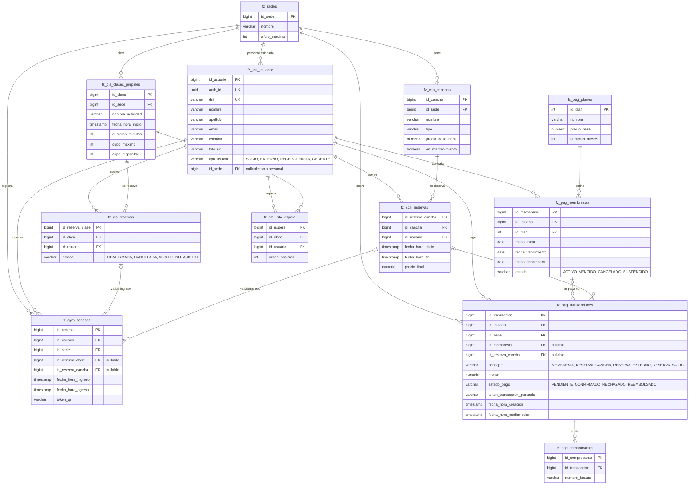

# DER — FitZone Sports

Modelo físico de la base (PostgreSQL 16) tal como lo generan las entidades JPA de `fz-backend`. Actualizado en [SCRUM-93](https://integrador-p5.atlassian.net/browse/SCRUM-93).

Todas las tablas heredan de `BaseEntity` las columnas de auditoría `created_at`, `updated_at`, `created_by`, `updated_by`, `is_deleted` y `deleted_at`; en el diagrama se omiten.

## Claves foráneas

| Tabla | Columna | Referencia | Constraint | Mapeo JPA |
|---|---|---|---|---|
| `fz_usr_usuarios` | `id_sede` | `fz_sedes` | `fk_usr_usuarios_sedes` | `Long idSede` + `@ManyToOne` de solo lectura para la FK |
| `fz_pag_membresias` | `id_usuario` | `fz_usr_usuarios` | `fk_pag_membresias_usuarios` | `@ManyToOne` |
| `fz_pag_membresias` | `id_plan` | `fz_pag_planes` | `fk_pag_membresias_planes` | `@ManyToOne` |
| `fz_cch_canchas` | `id_sede` | `fz_sedes` | `fk_cch_canchas_sedes` | `@ManyToOne` |
| `fz_cch_reservas` | `id_cancha` | `fz_cch_canchas` | `fk_cch_reservas_canchas` | `@ManyToOne` |
| `fz_cch_reservas` | `id_usuario` | `fz_usr_usuarios` | `fk_cch_reservas_usuarios` | `@ManyToOne` |
| `fz_cls_clases_grupales` | `id_sede` | `fz_sedes` | `fk_cls_clases_sedes` | `@ManyToOne` |
| `fz_cls_reservas` | `id_clase` | `fz_cls_clases_grupales` | `fk_cls_reservas_clases` | `@ManyToOne` |
| `fz_cls_reservas` | `id_usuario` | `fz_usr_usuarios` | `fk_cls_reservas_usuarios` | `@ManyToOne` |
| `fz_cls_lista_espera` | `id_clase` | `fz_cls_clases_grupales` | `fk_cls_lista_espera_clases` | `@ManyToOne` |
| `fz_cls_lista_espera` | `id_usuario` | `fz_usr_usuarios` | `fk_cls_lista_espera_usuarios` | `@ManyToOne` |
| `fz_gym_accesos` | `id_usuario` | `fz_usr_usuarios` | `fk_gym_accesos_usuarios` | `@ManyToOne` |
| `fz_gym_accesos` | `id_sede` | `fz_sedes` | `fk_gym_accesos_sedes` | `@ManyToOne` |
| `fz_gym_accesos` | `id_reserva_clase` | `fz_cls_reservas` | `fk_gym_accesos_reservas_clase` | `@ManyToOne` |
| `fz_gym_accesos` | `id_reserva_cancha` | `fz_cch_reservas` | `fk_gym_accesos_reservas_cancha` | `@ManyToOne` |
| `fz_pag_transacciones` | `id_usuario` | `fz_usr_usuarios` | `fk_pag_transacciones_usuarios` | `@ManyToOne` |
| `fz_pag_transacciones` | `id_sede` | `fz_sedes` | `fk_pag_transacciones_sedes` | `@ManyToOne` |
| `fz_pag_transacciones` | `id_membresia` | `fz_pag_membresias` | `fk_pag_transacciones_membresias` | `@ManyToOne` |
| `fz_pag_transacciones` | `id_reserva_cancha` | `fz_cch_reservas` | `fk_pag_transacciones_reservas_cancha` | `@ManyToOne` |
| `fz_pag_comprobantes` | `id_transaccion` | `fz_pag_transacciones` | `fk_pag_comprobantes_transacciones` | `@ManyToOne` |

Todas las relaciones son `@ManyToOne(fetch = LAZY)`. La única que no se navega desde el código es la de `Usuario` con su sede: ninguna respuesta necesita la sede completa del usuario, así que se sigue leyendo y escribiendo con `idSede` y la asociación solo existe para que Hibernate cree la FK.

## Restricciones CHECK

| Tabla | Constraint | Regla |
|---|---|---|
| `fz_gym_accesos` | `ck_gym_accesos_una_reserva` | `id_reserva_clase` e `id_reserva_cancha` no pueden venir los dos. |
| `fz_pag_transacciones` | `ck_pag_transacciones_origen` | `MEMBRESIA` lleva solo `id_membresia`; `RESERVA_CANCHA` lleva solo `id_reserva_cancha`; `RESERVA_EXTERNO` y `RESERVA_SOCIO` (valores heredados) no llevan `id_membresia`. |
| `fz_pag_transacciones` | `fz_pag_transacciones_concepto_check` | `concepto` es uno de los 4 valores de `TipoOrigenTransaccion`. |
| `fz_usr_usuarios`, `fz_pag_membresias`, `fz_cls_reservas`, `fz_pag_transacciones` | `*_check` | Hibernate restringe cada columna de enum a sus valores. |

## Bases ya creadas

`ddl-auto=update` crea FK y CHECK solo al crear una tabla, y en prod (`validate`) no crea nada. Para dejar una base existente igual que una nueva hay que correr una vez [`sql/SCRUM-93-restricciones.sql`](./sql/SCRUM-93-restricciones.sql) (instrucciones en el encabezado del script). Entre otras cosas corrige `fz_pag_transacciones_concepto_check`, que en las bases viejas solo aceptaba `RESERVA_EXTERNO` y `RESERVA_SOCIO` y rechazaba los pagos de membresía y de cancha.
