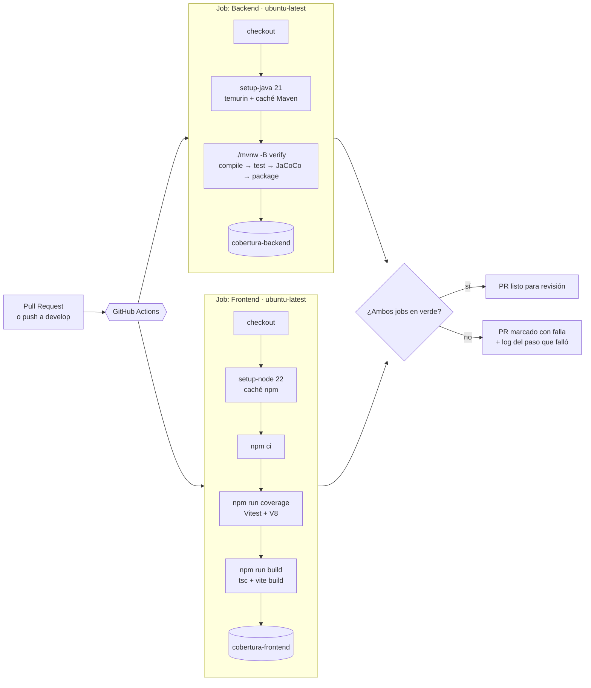

# Pipeline de integración continua y cobertura

Este documento describe el pipeline de CI de FitZone Sports: qué valida, por qué está armado así, cómo reproducirlo en local y cómo leer los reportes de cobertura que genera.

- **Definición:** [`.github/workflows/ci.yml`](../.github/workflows/ci.yml)
- **Ticket:** SCRUM-111 (Unidad V)
- **Plataforma:** GitHub Actions

---

## 1. Qué hace

Cada Pull Request hacia `develop`, y cada push a `develop`, dispara dos jobs que corren en paralelo y de forma independiente:

| Job | Qué valida | Artefacto que publica |
| :-- | :-- | :-- |
| **Backend** | Compila `fz-backend` con Java 21, corre la suite de JUnit 5 y empaqueta el jar. | `cobertura-backend`: reporte HTML de JaCoCo |
| **Frontend** | Instala dependencias exactas del lockfile, corre la suite de Vitest con cobertura, chequea los tipos con `tsc` y hace el build de producción con Vite. | `cobertura-frontend`: reporte HTML de V8 |

Un PR queda en verde solo si los dos jobs pasan. Si alguno falla, GitHub lo muestra en el PR con el paso exacto y su log.

## 2. Diagrama



GitHub dibuja el diagrama directamente a partir del bloque Mermaid, que es su fuente editable.

## 3. Etapas en detalle

### 3.1 Backend

| Paso | Comando | Por qué |
| :-- | :-- | :-- |
| Checkout | `actions/checkout@v4` | Trae el commit exacto del PR. |
| Java | `actions/setup-java@v4` (temurin 21, `cache: maven`) | Misma versión que `java.version` del `pom.xml`. La caché evita descargar las dependencias en cada corrida. |
| Tests y build | `./mvnw -B verify` | `verify` recorre todas las fases hasta `package`: compila, corre los tests, genera el reporte de JaCoCo y arma el jar. Así se valida también que el artefacto desplegable se pueda construir, no solo que los tests pasen. `-B` (batch) saca la salida interactiva del log. |
| Cobertura | `actions/upload-artifact@v4` con `if: always()` | Se publica aunque fallen los tests, porque en ese caso el reporte es justamente lo que más sirve. |

El job no necesita un servicio de PostgreSQL. La configuración de test (`src/test/resources/application.properties`) excluye el autoconfigurado de DataSource y JPA. Los controladores se prueban con `@WebMvcTest`, que solo levanta la capa web, y los servicios con Mockito, con los repositorios simulados. Eso deja la suite rápida y determinista, aunque deja sin cubrir las consultas reales contra la base (ver sección 7).

### 3.2 Frontend

| Paso | Comando | Por qué |
| :-- | :-- | :-- |
| Node | `actions/setup-node@v4` (22, `cache: npm`) | Versión LTS actual. La caché se indexa por `package-lock.json`. |
| Dependencias | `npm ci` | Instala exactamente lo que fija el lockfile y falla si `package.json` y el lockfile no coinciden. `npm install` podría resolver versiones distintas a las que probó el desarrollador. |
| Tests con cobertura | `npm run coverage` (`vitest run --coverage`) | Corre la suite una sola vez, sin modo watch, e instrumenta el código con el motor de cobertura nativo de V8. |
| Build | `npm run build` (`tsc && vite build`) | Es el chequeo de tipos del proyecto: Vitest transpila sin verificar tipos, así que un error de TypeScript solo aparece acá. |
| Cobertura | `actions/upload-artifact@v4` con `if: always()` | Igual que en el backend. |

### 3.3 Comportamiento general

- **Cancelación de corridas viejas:** el bloque `concurrency` agrupa las corridas por rama y cancela la anterior cuando llega un commit nuevo al mismo PR. Solo importa el resultado del último commit.
- **Jobs independientes:** una falla del frontend no oculta el resultado del backend, y al revés. Los dos se ven en el mismo PR.
- **Permiso de ejecución de `mvnw`:** el wrapper de Maven está versionado con modo `100755`. En un runner Linux, sin ese bit `./mvnw` falla con *permission denied*.

## 4. Decisiones y alternativas

| Decisión | Alternativas consideradas | Motivo |
| :-- | :-- | :-- |
| GitHub Actions | GitLab CI, Jenkins, CircleCI | El repositorio ya está en GitHub. Actions integra el estado de los checks en el PR sin servidores ni cuentas extra, y el plan gratuito alcanza para un repo de este tamaño. Jenkins exigiría mantener un servidor propio. |
| Un workflow con dos jobs paralelos | Un solo job secuencial; un workflow por proyecto | En paralelo el tiempo total es el del job más lento y no la suma. Un único archivo mantiene en un solo lugar la definición de "qué tiene que pasar para mergear". |
| JaCoCo con agente en tiempo de ejecución (`prepare-agent`) | Instrumentación offline de JaCoCo; OpenClover | Es el estándar en Maven y no modifica las clases compiladas. El agente se suma al `argLine` que ya define el `pom.xml` (`-Dnet.bytebuddy.experimental=true`), así que Mockito sigue funcionando igual. La instrumentación offline solo hace falta cuando el agente no se puede usar, que no es el caso. |
| Proveedor `v8` en Vitest | `istanbul` | `v8` usa la cobertura que ya mide el motor de JavaScript, sin reescribir el código fuente, así que es más rápido y no altera lo que se ejecuta. `istanbul` instrumenta el código antes de correrlo; es más preciso en algunos casos borde, pero más lento. Para la suite actual la diferencia no justifica el costo. |
| Reporte HTML como artefacto | Servicio externo (Codecov, Coveralls); comentario automático en el PR | El artefacto no requiere cuentas ni tokens, y se puede descargar y abrir offline. Un servicio externo agrega historial y comentarios en el PR, pero suma una integración y un secreto más que mantener. |
| Sin umbral mínimo por ahora | Fallar el pipeline por debajo de un porcentaje | El umbral es una decisión de estrategia de pruebas y va en su propio ADR. Fijarlo antes de medir la línea base podría elegir un número arbitrario. Los valores actuales (sección 6) sirven de punto de partida. |

## 5. Cómo reproducirlo en local

Los mismos comandos del pipeline, desde la raíz del repo:

```bash
cd fz-backend && ./mvnw verify
```

```bash
cd fz-frontend && npm ci && npm run coverage && npm run build
```

Reportes generados:

| Proyecto | Archivo a abrir |
| :-- | :-- |
| Backend | `fz-backend/target/site/jacoco/index.html` |
| Frontend | `fz-frontend/coverage/index.html` |

`npm test` sigue existiendo y corre la suite sin cobertura, que es más rápido para el trabajo diario.

### Pruebas que dependen de la fecha

Los componentes de canchas marcan como "pasados" los turnos anteriores al momento actual. Una prueba con una fecha fija escrita a mano pasa hoy y falla cuando esa fecha queda atrás, sin que el código haya cambiado. Por eso las pruebas de `GrillaDisponibilidad` y `CanchasPage` fijan el reloj:

```ts
beforeEach(() => {
  vi.useFakeTimers({ toFake: ['Date'] });
  vi.setSystemTime(new Date('2026-10-20T10:00:00'));
});
afterEach(() => {
  vi.useRealTimers();
});
```

`toFake: ['Date']` falsea solo `Date`. Si se falsearan también `setTimeout` y `setInterval`, `waitFor` de Testing Library dejaría de avanzar y las pruebas asíncronas quedarían colgadas. Toda prueba nueva que dependa de "hoy" debe fijar el reloj así o calcular las fechas relativas a `Date.now()`.

## 6. Cómo leer los reportes

### 6.1 Descargarlos desde GitHub

1. Abrir el PR y entrar en **Checks**, o ir a la pestaña **Actions** del repositorio.
2. Elegir la corrida del workflow **CI**.
3. Al pie del resumen, en **Artifacts**, descargar `cobertura-backend` o `cobertura-frontend`.
4. Descomprimir y abrir `index.html` en el navegador.

Los artefactos se conservan 90 días, que es el valor por defecto de GitHub.

### 6.2 JaCoCo (backend)

La página principal lista los paquetes. Cada columna es un contador distinto:

| Contador | Qué mide |
| :-- | :-- |
| Instrucciones | Bytecode ejecutado. Es la métrica más fina y la que JaCoCo muestra como porcentaje principal. |
| Ramas | Caminos de cada `if`, `switch` y operador ternario. Una rama cubierta a medias indica una condición probada solo por uno de sus lados. |
| Complejidad ciclomática | Cantidad mínima de caminos independientes. Si hay muchos sin cubrir, faltan casos de prueba aunque las líneas figuren ejecutadas. |
| Líneas, métodos, clases | Unidades del código fuente que se ejecutaron al menos una vez. |

Al entrar a una clase se ve el código fuente coloreado: **verde** es ejecutado, **rojo** es no ejecutado, y **amarillo** es una rama cubierta en parte. Pasando el mouse por el rombo del margen, JaCoCo dice cuántas ramas de esa línea faltan.

### 6.3 V8 (frontend)

| Métrica | Qué mide |
| :-- | :-- |
| Statements | Sentencias ejecutadas. |
| Branches | Caminos de condicionales, `&&`, `\|\|`, `??` y valores por defecto. |
| Functions | Funciones invocadas al menos una vez, incluidos los handlers de eventos. |
| Lines | Líneas ejecutadas. |

La consola muestra el resumen al terminar `npm run coverage`. El HTML permite bajar por carpeta hasta el archivo, con las líneas no cubiertas resaltadas.

### 6.4 Estado actual

Medido sobre `origin/develop` (`92c211a`) más los cambios de SCRUM-111, el 2026-11-07.

| Proyecto | Pruebas | Cobertura |
| :-- | :-- | :-- |
| Backend | 248, 0 fallas | Instrucciones 64 % · Ramas 47 % · Líneas 65 % · Métodos 65 % |
| Frontend | 353 en 56 archivos, 0 fallas | Statements 66 % · Branches 64 % · Functions 63 % · Lines 69 % |

Lectura por paquete del backend:

- **Mejor cubiertos:** `canchas.strategy` (98 % de instrucciones, 90 % de ramas), que concentra el cálculo de precios y es la lógica de negocio con más combinaciones; `pagos.service` (92 %); y `clases.service` (77 %).
- **Menos cubiertos:** `core.config` (27 %), `core.controller` (24 %) y `pagos.pasarela` (26 %). Los dos primeros contienen la semilla de datos, la configuración de Spring y endpoints de diagnóstico, que se verifican levantando la aplicación y no con pruebas unitarias. `pagos.pasarela` es la pasarela simulada (`PasarelaMock`).
- **Ramas en 47 %:** buena parte de las líneas se ejecutan, pero no todas las condiciones se prueban por los dos lados. Es la métrica que más información da sobre qué casos faltan.

## 7. Qué cubre la suite y qué no

Composición actual:

| Nivel | Backend | Frontend |
| :-- | :-- | :-- |
| Unitarias | 13 clases de servicios con Mockito; repositorios simulados | Componentes (25 archivos), servicios (7) y utilidades y flujos por dominio en `src/test` (18) |
| Integración de capa | 12 clases `@WebMvcTest`: ruteo, validación con Bean Validation y formato de error de `GlobalExceptionHandler` | Páginas completas con contextos y servicios simulados (5 archivos) |
| Arranque | 1 `@SpringBootTest` de carga de contexto | `App.test.tsx` |

No están cubiertas hoy, y conviene tenerlas presentes al leer los porcentajes:

- **Persistencia real:** ninguna prueba corre contra PostgreSQL, así que las consultas de los repositorios y el `@Lock(PESSIMISTIC_WRITE)` no se ejercitan.
- **Concurrencia:** no hay una prueba que lance dos reservas simultáneas de la misma cancha y verifique que se confirma exactamente una (RN-02). Necesita una base real, por ejemplo con Testcontainers.
- **End-to-end:** no hay pruebas que recorran el sistema desde el navegador contra el backend.

## 8. Próximos pasos

| Paso | Dónde se resuelve |
| :-- | :-- |
| Declarar el umbral mínimo de cobertura y hacer que el pipeline falle por debajo (`jacoco:check` y `coverage.thresholds` de Vitest) | ADR de estrategia de pruebas |
| Requerir que el check **CI** pase antes de mergear a `develop` | GitHub → Settings → Branches → regla de protección de `develop` |
| Prueba de concurrencia de reservas contra PostgreSQL | Testcontainers en `fz-backend` |
| Etapa de entrega continua: build de imágenes y despliegue al entorno de pruebas | ADR de despliegue; hoy Render y Vercel despliegan por su cuenta al detectar cambios en la rama |
| Exportar el diagrama de la sección 2 a SVG | `npx @mermaid-js/mermaid-cli -i diagrama.mmd -o diagrama.svg` |

---

*Diagrama del pipeline · versión 1.0 · 2026-11-07 · Leiva, Marcos Joel*
