# Manual de usuario — FitZone Sports

- **Versión:** 1.0 · **Fecha:** 2026-11-10 · **Autor:** Leiva, Marcos Joel (Grupo 5)

## 1. Qué es FitZone Sports

FitZone Sports es la plataforma web de una cadena de gimnasios con varias sedes. Desde el navegador, cada persona hace lo que le corresponde según su rol:

| Rol | Qué hace |
|---|---|
| **Socio** | Muestra su pase QR para entrar, reserva clases grupales y canchas con descuento, paga y descarga comprobantes |
| **Cliente externo** | Reserva y paga una cancha sin crear cuenta |
| **Recepcionista** | Valida ingresos con el QR, controla el aforo, gestiona usuarios y membresías de su sede |
| **Gerente central** | Todo lo anterior en cualquier sede, más la gestión de canchas, clases, sedes y roles |

## 2. Cómo leer este manual

Cada rol tiene su capítulo. Las capturas son de la versión web en modo demostración (datos de ejemplo); en producción los nombres y montos son los reales.

Para probar el sistema con los datos semilla (contraseña de todos: `password123`):

| Rol | Email |
|---|---|
| Gerente | `gerente@fitzone.com` |
| Recepcionista | `recepcionista@fitzone.com` |
| Socio con membresía activa | `socio@fitzone.com` |
| Socio con membresía vencida | `socio.vencido@fitzone.com` |
| Cliente externo | No inicia sesión: usa la reserva de canchas sin cuenta |

### Glosario

| Término | Significado |
|---|---|
| Sede activa | La sede sobre la que se está trabajando. Se elige arriba, en el centro de la pantalla. El recepcionista la tiene fija |
| Membresía | Plan contratado (Mensual, Trimestral o Anual VIP). Estados: ACTIVO, VENCIDO, SUSPENDIDO, CANCELADO |
| Pase QR | Código que identifica al socio en el ingreso. Cambia cada 60 segundos y sirve una sola vez |
| Aforo | Cantidad máxima de personas a la vez dentro de una sede |
| Lista de espera | Cola de socios para una clase sin cupo |
| Horario pico | De 19 a 21 h. Los turnos de cancha en esa franja tienen recargo |

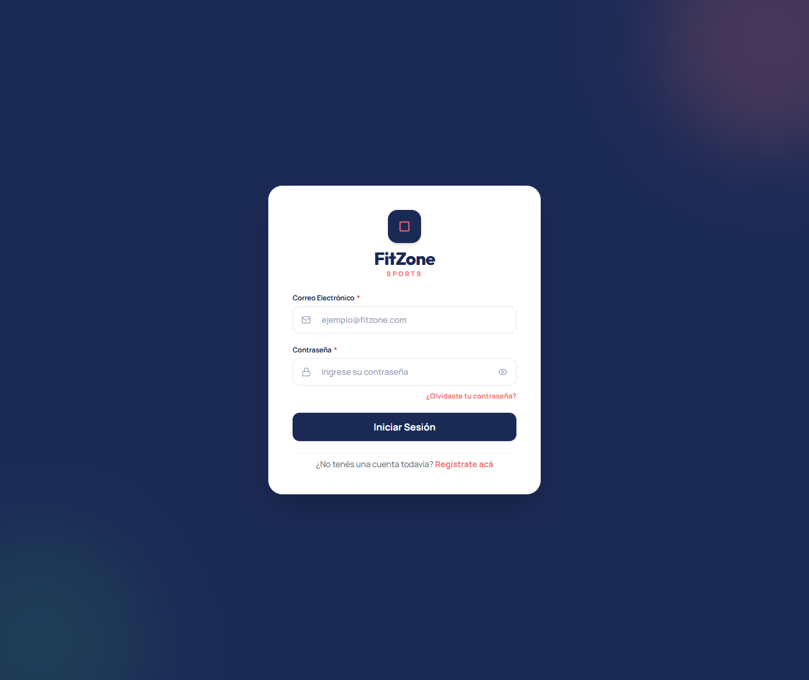

Al iniciar sesión, cada rol entra a su pantalla principal: el socio a *Mi Pase QR*, el recepcionista y el gerente a *Control Acceso*. El menú de la izquierda muestra solo lo que el rol puede usar.

## 3. Manual del Socio

### 3.1 Registro y carga del perfil

La cuenta del socio la crea la recepción al asociarle una membresía (4.5). El socio recibe un mail de invitación para definir su contraseña y después entra con su email.

La pantalla *Registrarse* (`/registro`) existe en la web, pero **todavía no está conectada al servidor**: el alta pública no funciona fuera del modo demostración.

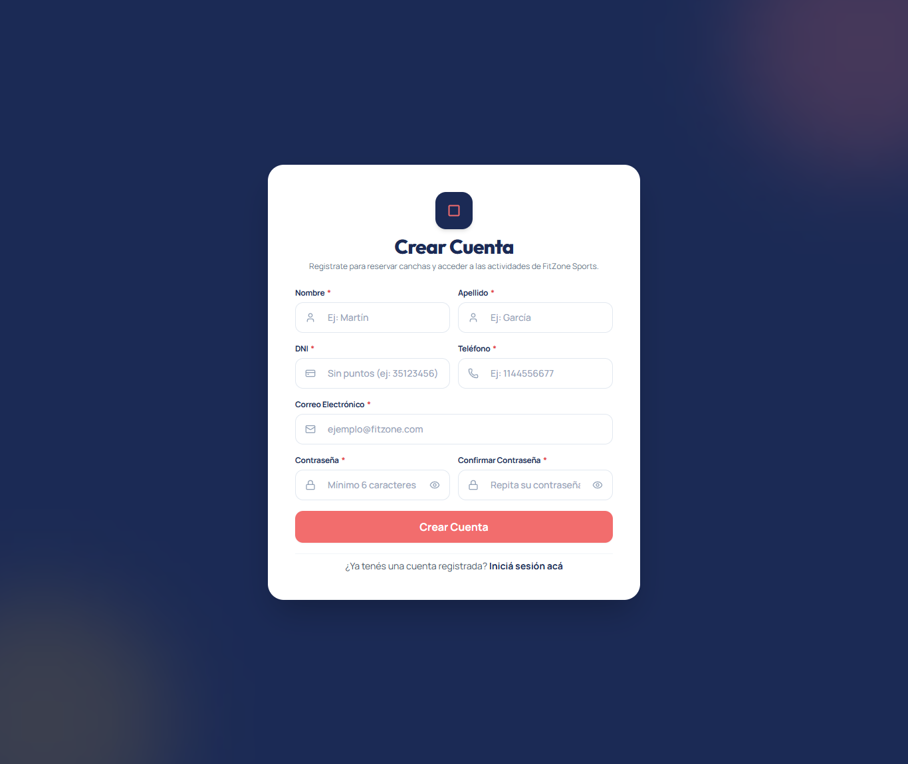

### 3.2 Contratación y renovación de la membresía

La membresía se asocia en la recepción (4.5). Una vez asociada, el socio la ve en *Mi Pase QR* con el plan, la fecha de vencimiento y los días restantes. Si faltan pocos días, aparece el aviso *Membresía próxima a vencer* con el botón *Renovar ahora*.

Para pagar la renovación desde la web: menú *Pagos* → *Checkout / Pagar*, elegir el ítem *Renovación Membresía*, revisar el resumen y presionar *Pagar*.

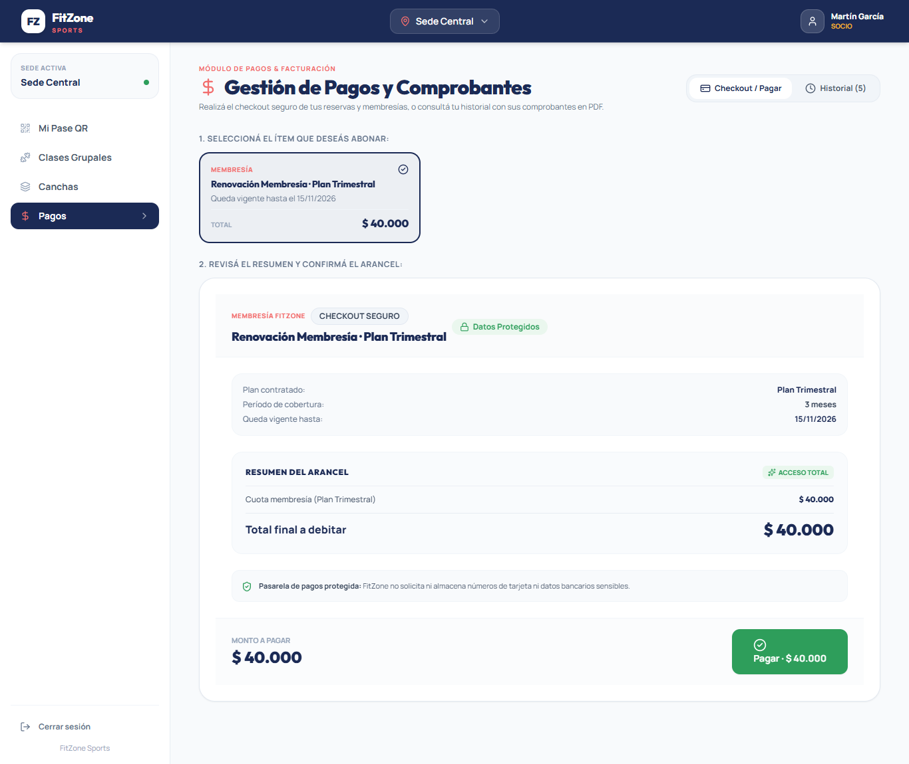

Todos los días a las 00:00 el sistema pasa a VENCIDO las membresías cuya fecha ya pasó.

### 3.3 Ingreso al gimnasio con el código QR

1. Abrir *Mi Pase QR* en el celular.
2. Mostrar el código en la recepción. El código se renueva solo cada 60 segundos; la barra indica cuánto le queda.
3. La recepción lo lee y, si todo está en regla, registra el ingreso.

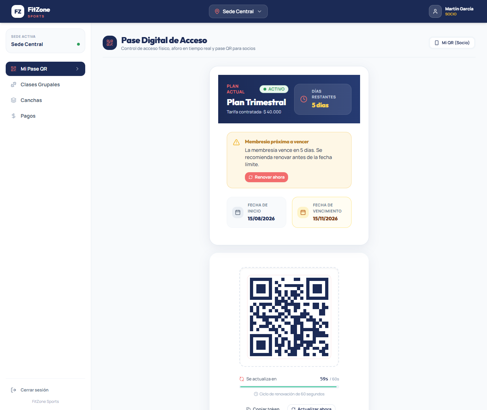

Se puede entrar en cualquier sede de la cadena. No se puede tener dos ingresos abiertos a la vez: hay que registrar la salida antes de volver a entrar.

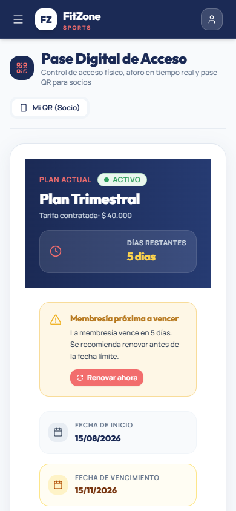

### 3.4 Qué hacer si el QR no funciona o no hay señal

| Mensaje | Qué significa | Qué hacer |
|---|---|---|
| *Código QR Inhabilitado* / *Sin Membresía Activa* | La membresía no está ACTIVA | Pagar la renovación (3.2) o acercarse a la recepción |
| QR vencido | El código tenía más de 60 segundos | Presionar *Actualizar ahora* y mostrarlo de nuevo |
| QR ya utilizado | Ese código ya se usó para un ingreso | Esperar el código siguiente |
| Ya tenés un ingreso abierto | No se registró la salida anterior | Pedir en la recepción que registre el egreso |
| Aforo completo | La sede está llena | Esperar a que salga alguien u otra sede |

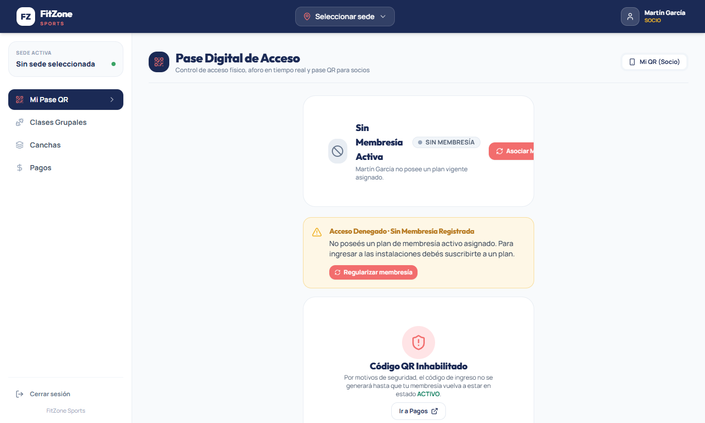

**Sin señal:** el pase QR necesita conexión para mostrarse y la recepción necesita conexión para validarlo. Hoy **no existe un modo sin conexión**. Si falla internet, la recepción registra el ingreso a mano con el DNI (ver 4.4).

### 3.5 Reserva de clases grupales y lista de espera

Menú *Clases Grupales*. Cada tarjeta muestra la actividad, el horario, la duración y los cupos.

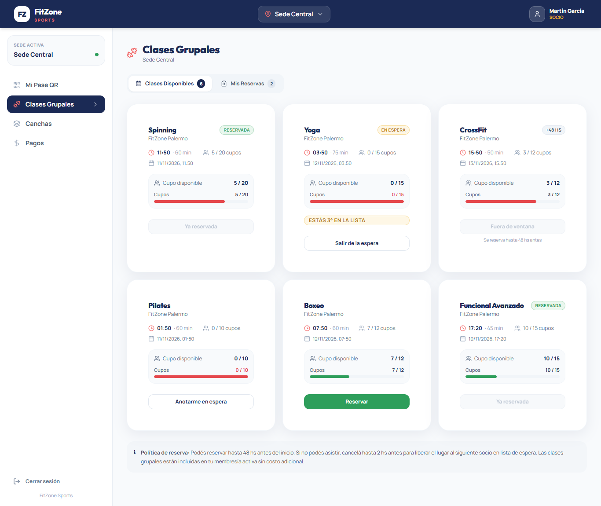

- **Reservar:** botón verde *Reservar*. Se puede reservar hasta 48 horas antes del inicio; más adelante la tarjeta dice *Fuera de ventana*.
- **Clase llena:** botón *Anotarme en espera*. La tarjeta muestra la posición (por ejemplo, *Estás 3° en la lista*).
- **Si se libera un cupo:** el primer socio de la lista recibe un aviso para entrar a reservar. El cupo no se asigna solo. *Nota:* hoy el aviso queda registrado en el sistema, pero no se envía por mail ni notificación.
- **Salir de la lista:** botón *Salir de la espera*.
- Las reservas propias están en la pestaña *Mis Reservas*.

Las clases están incluidas en la membresía activa, sin costo adicional.

### 3.6 Reserva de canchas y cómo se calcula el precio

Menú *Canchas* → *Reservar Cancha*:

1. Elegir la cancha. Se puede filtrar por tipo (Pádel, Fútbol 5, Tenis). Las canchas *En mantenimiento* no se pueden reservar.
2. Elegir la fecha.
3. Elegir el turno. Los turnos son de horas enteras, entre las 8 y las 23. Los ocupados o ya pasados aparecen deshabilitados.
4. Revisar la cotización y confirmar. Si otra persona reservó el mismo turno un instante antes, el sistema avisa que ya está ocupado y hay que elegir otro.

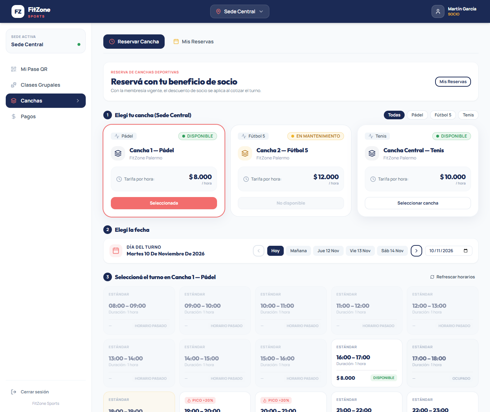

Cálculo del precio:

| Concepto | Regla |
|---|---|
| Precio base | Tarifa por hora de la cancha × horas |
| Recargo por horario pico | +20 % de la tarifa por cada hora entre las 19 y las 21 |
| Descuento de socio | −15 % del precio base, solo con membresía ACTIVA |
| Total | Base − descuento + recargo |

Ejemplo: cancha de $10.000/h, de 19 a 20 h, socio activo: 10.000 − 1.500 + 2.000 = **$10.500**. Un socio con la membresía vencida puede reservar igual, pero paga como cliente externo: **$12.000**.

**Cliente externo (sin cuenta):** entra a *Canchas* sin iniciar sesión, elige cancha y turno, carga sus datos y paga. Recibe un código de reserva para consultarla y descargar el comprobante.

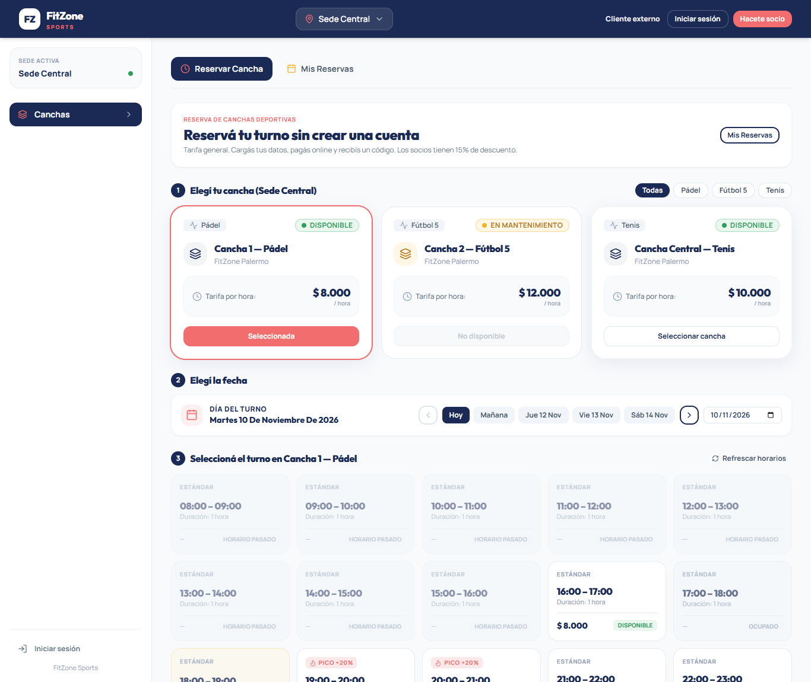

### 3.7 Cancelaciones, plazos y penalidades

| Qué | Plazo | Cómo |
|---|---|---|
| Reserva de clase | Hasta 2 horas antes del inicio | *Clases Grupales* → *Mis Reservas* → *Cancelar*. El cupo se libera y se avisa al primero de la lista de espera |
| Reserva de cancha | — | **No se puede cancelar desde la web.** Hay que pedirlo en la recepción |

El sistema no aplica penalidades económicas por cancelar ni por no asistir.

### 3.8 Comprobantes de pago

Menú *Pagos* → *Historial*. Cada pago confirmado tiene su comprobante en PDF para descargar. Los pagos pendientes o rechazados no tienen comprobante.

El sistema no pide ni guarda datos de tarjeta: el cobro lo procesa la pasarela de pagos. En esta versión la pasarela es simulada.

## 4. Manual del Recepcionista

El recepcionista opera solo la sede que tiene asignada; el selector de sede aparece con un candado.

### 4.1 Validación de ingreso y lectura del aforo

Menú *Control Acceso*.

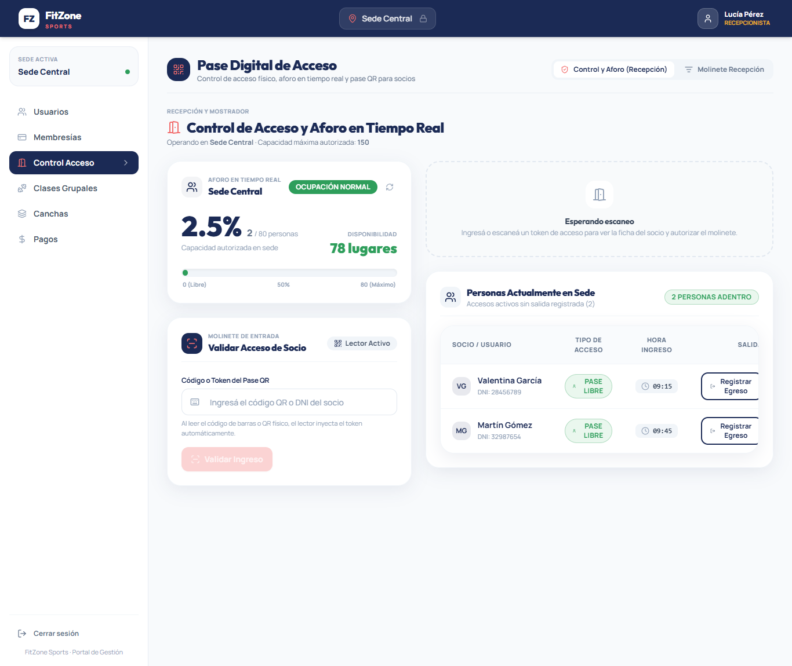

1. **Aforo en tiempo real:** porcentaje de ocupación, personas adentro y lugares libres. El indicador cambia de color al acercarse al máximo.
2. **Validar Acceso de Socio:** leer el QR con el lector (carga el código solo) o pegarlo en el campo, y presionar *Validar Ingreso*. Si se aprueba, aparece la ficha del socio y se registra el ingreso. Si se rechaza, se muestra el motivo (3.4).
3. **Personas Actualmente en Sede:** lista de ingresos sin salida. *Registrar Egreso* cierra el acceso y libera el lugar en el aforo.

### 4.2 Gestión de la agenda de clases

El recepcionista **consulta** la agenda en *Clases Grupales* y ve los inscriptos y la lista de espera de cada clase. Crear, modificar o eliminar clases lo hace el gerente (5.2).

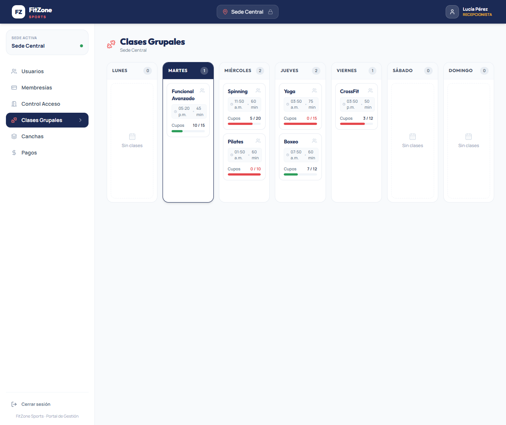

### 4.3 Inhabilitación de una cancha por mantenimiento

En esta versión, poner o sacar una cancha de mantenimiento lo hace **el gerente** (*Canchas* → *Gestión de Canchas*). El recepcionista ve el estado *En mantenimiento* en la grilla y debe pedírselo al gerente.

### 4.4 Problemas frecuentes del mostrador

| Problema | Solución |
|---|---|
| El socio dice que pagó pero figura VENCIDO | Buscarlo en *Membresías* por DNI y revisar el último pago en *Pagos*. Si el pago está confirmado, renovar la membresía |
| *Ya tiene un ingreso abierto* | Buscarlo en *Personas Actualmente en Sede* y registrar el egreso pendiente |
| Aforo completo | No se puede registrar el ingreso hasta que alguien salga |
| Se cayó internet | Anotar en planilla DNI, nombre y hora de cada ingreso, y cargarlos cuando vuelva la conexión. Mientras tanto, el sistema no controla aforo ni membresías |
| El QR no se lee | Pedir al socio que presione *Actualizar ahora* y volver a leer |

### 4.5 Usuarios y membresías

- *Usuarios*: alta de socios y personal de la sede, búsqueda y edición. El alta envía al usuario un mail para definir su contraseña.

  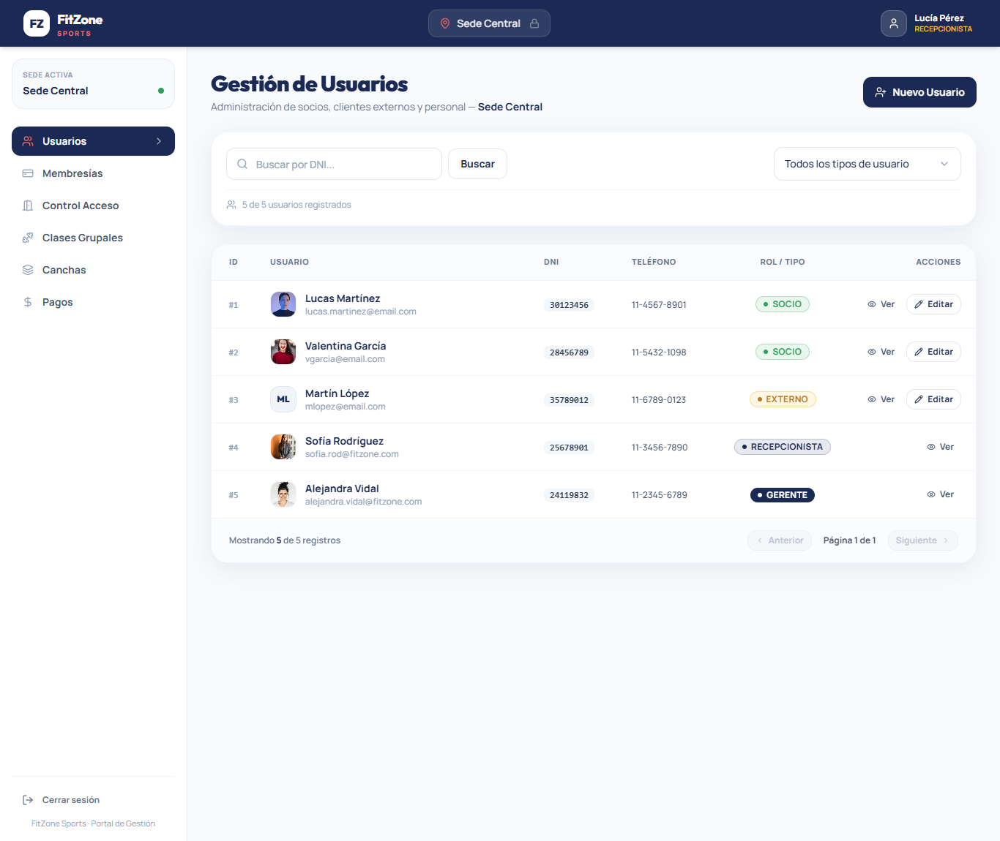

- *Membresías*: buscar al socio por DNI, ver su estado, y con *Asociar / Renovar Plan* elegir uno de los planes del catálogo. Desde *Gestionar* se cambia el estado (por ejemplo, suspender).

  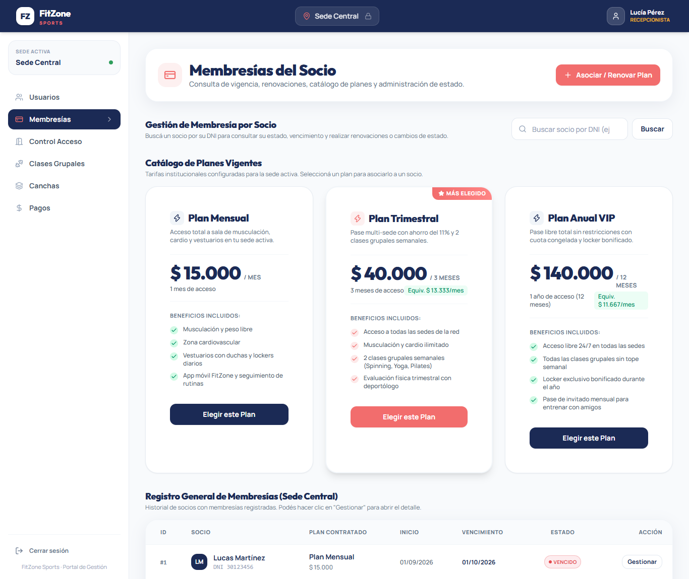

## 5. Manual del Gerente central

El gerente ve todas las sedes y tiene, además de las opciones de recepción, la gestión de canchas, clases y roles.

### 5.1 Alta y configuración de una sede

El alta de sedes **no tiene pantalla en la web**: se hace por la API (`POST /api/v1/sedes`, con nombre y aforo máximo), como se explica en el [manual de instalación y operación](manual-instalacion-operacion.md#9-alta-de-una-sede-nueva-sin-detener-el-sistema). No hace falta detener el sistema. Una vez creada, la sede aparece en el selector y el gerente le agrega canchas y clases desde la web.

### 5.2 Definición de precios, descuentos y horario pico

- **Tarifa de cada cancha:** *Canchas* → *Gestión de Canchas* → crear o editar la cancha y su tarifa por hora. Desde ahí también se pone o se saca de mantenimiento.

  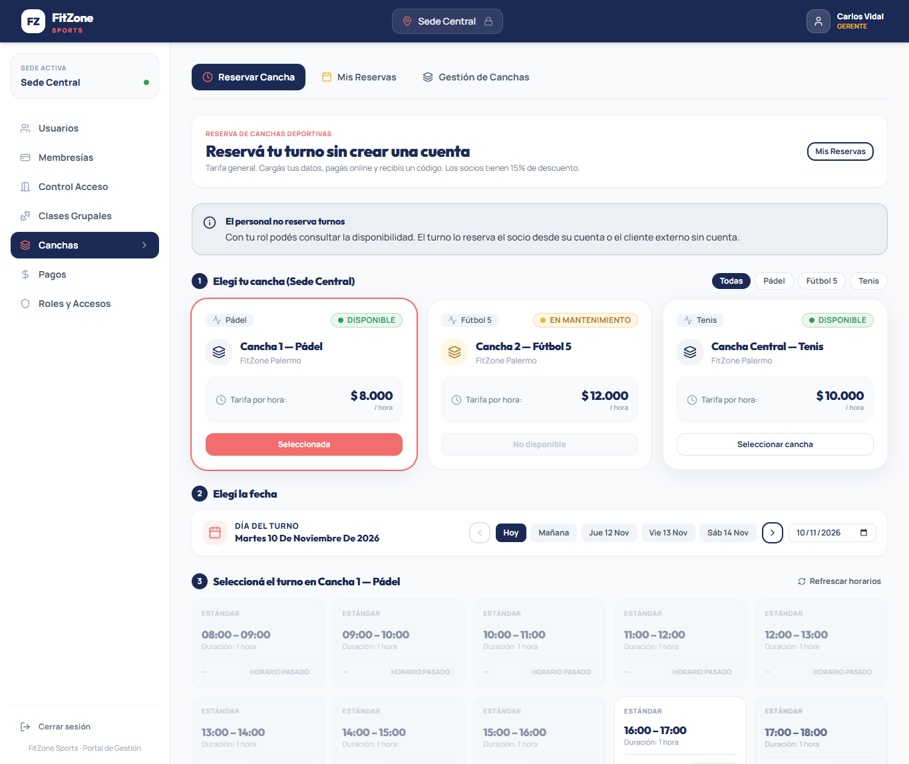

- **Descuento de socio (15 %) y recargo de horario pico (20 %, de 19 a 21 h):** son parámetros del sistema, no se cambian desde la web. El recargo se configura en el servidor (`fitzone.canchas.recargo-pico-porcentaje`); el descuento requiere un cambio de código.
- **Planes de membresía:** se consultan en *Membresías*; no hay pantalla para editar sus precios.
- **Clases:** *Clases Grupales* → *Programar Nueva Clase* (actividad, sede, horario, duración y cupo). Desde cada tarjeta se edita o elimina.

  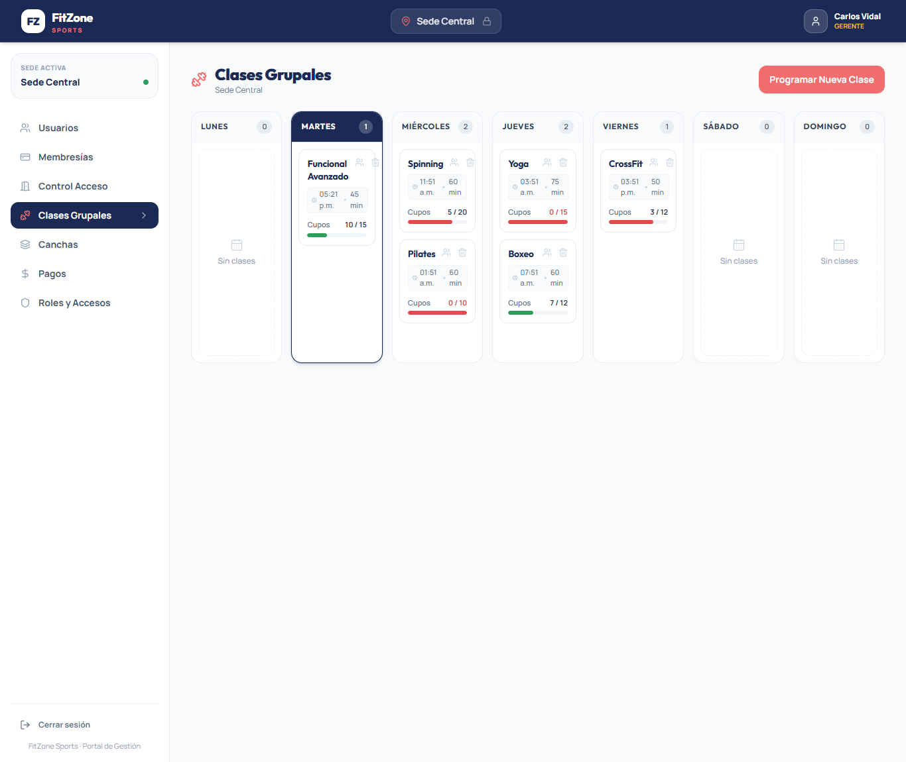

- **Roles y Accesos:** pantalla para definir qué ve cada rol en el menú. *Atención:* estos cambios se guardan solo en el navegador del gerente y no cambian los permisos reales del sistema.

  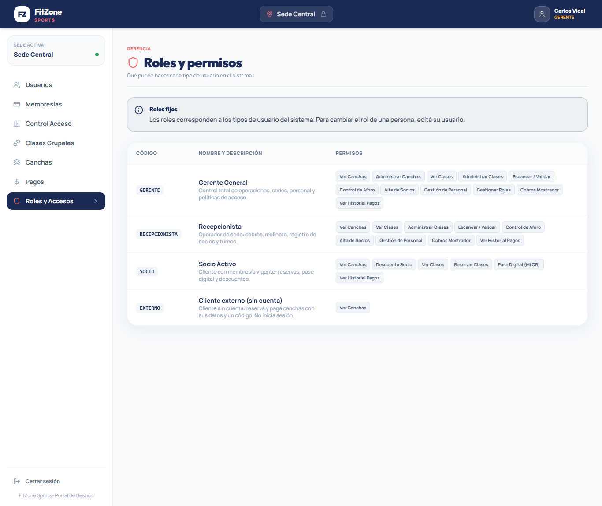

### 5.3 Lectura de los reportes consolidados

**No hay reportes consolidados en esta versión.** Lo disponible para el gerente es:

- *Control Acceso*: aforo y personas adentro de la sede elegida.
- *Pagos*: historial de transacciones.
- *Membresías*: registro de membresías con su estado.

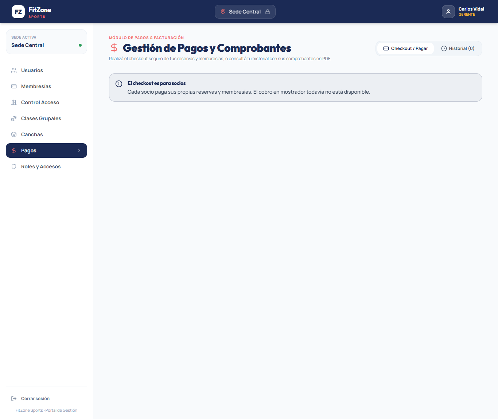

## 6. Preguntas frecuentes

**¿Puedo entrar a otra sede con mi membresía?**
Sí. La membresía activa permite entrar a cualquier sede de la cadena.

**¿Por qué cambia mi QR?**
Por seguridad: cada código dura 60 segundos y sirve para un solo ingreso. Una captura de pantalla vieja no sirve.

**¿Puedo usar el QR sin internet?**
No. En esta versión el pase y su validación necesitan conexión.

**Tengo la membresía vencida, ¿puedo alquilar una cancha?**
Sí, pero pagás la tarifa de cliente externo, sin el descuento de socio.

**Me anoté en la lista de espera, ¿me reservan el lugar solo?**
No. Cuando se libera un cupo se avisa al primero de la lista, que tiene que entrar a reservar.

**¿Puedo cancelar una reserva de cancha?**
Desde la web, no. Pedilo en la recepción.

**¿Guardan mis datos de tarjeta?**
No. El pago lo procesa la pasarela; FitZone solo guarda el resultado.

**Olvidé mi contraseña.**
La recuperación la gestiona Supabase Auth; pedí en la recepción que te reenvíen la invitación.
