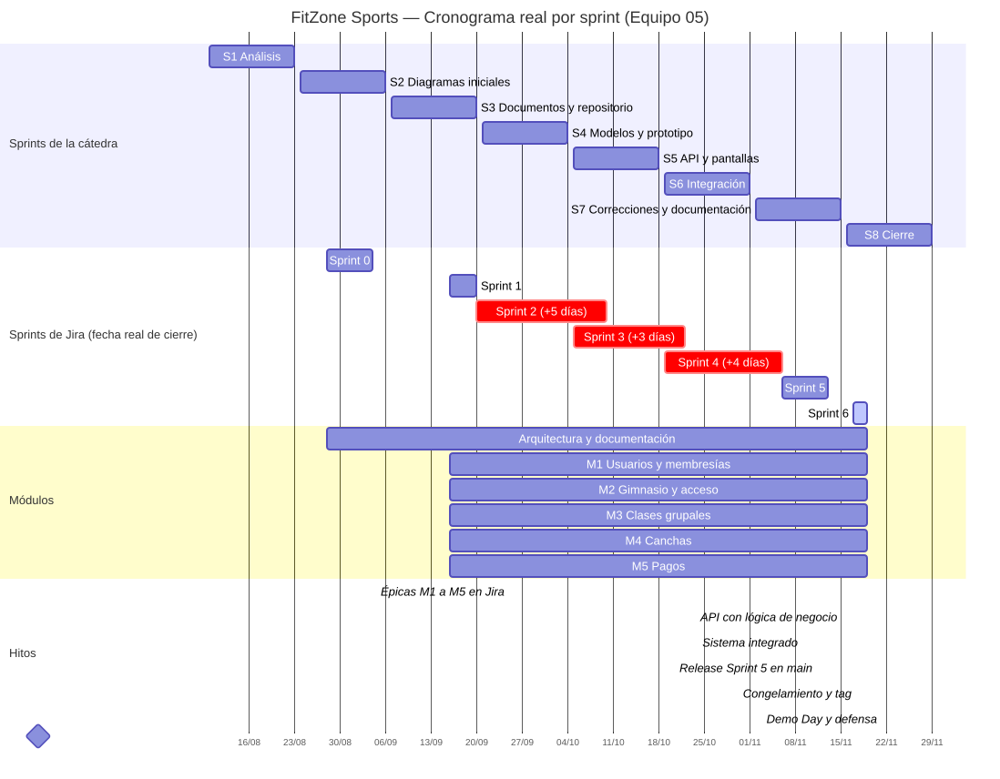

# Plan de proyecto — FitZone Sports — Equipo 05

> Fuentes: tablero de Jira del proyecto (`SCRUM`, 122 tarjetas en 7 sprints), bitácoras de `docs/bitacoras/`, ADR de `docs/adr/` e historial del repositorio. Corte: 2026-11-19. El tablero completo está exportado en [tablero/](tablero/).

## 1. Alcance

**Incluido:** una aplicación web para una cadena de gimnasios con 25 o más sedes, con un portal responsive para el socio y una consola para el personal, organizada en cinco módulos:

| Módulo | Requisitos | Qué se construye |
|---|---|---|
| M1 Usuarios y membresías | RF-01, RF-02, RF-03, RN-03 | Alta y perfil de usuarios por rol, planes, membresías con renovación, suspensión, cancelación y vencimiento diario, alta de socio online con pago |
| M2 Gimnasio y acceso | RF-04, RF-05, RN-01, RNF-01 | QR rotativo del socio, ingreso y egreso, aforo en tiempo real, ingreso multisede, terminal de sede que valida sin conexión y sincroniza al volver |
| M3 Clases grupales | RF-06, RF-07, RF-08 | Agenda por sede, reserva y cancelación con plazos, lista de espera con notificación (Observer) |
| M4 Canchas | RF-09 a RF-12, RN-02 | Gestión de canchas y mantenimiento, grilla de disponibilidad, precio dinámico (Strategy), reserva sin sobreventa, reserva de invitado sin cuenta |
| M5 Pagos | RF-13, RF-14, RNF-02 | Pasarela simulada, transacciones y comprobante en PDF |

Además: autenticación con Supabase Auth y permisos por rol, aislamiento por sede, despliegue en contenedores y pipeline de CI con cobertura.

**Excluido:**

| Qué queda afuera | Por qué | Referencia |
|---|---|---|
| App móvil nativa del socio | Un tercer cliente no entraba en el plazo; el QR sin conexión se resolvió en la web con firma en el dispositivo | SCRUM-113, ADR-003, ADR-020 |
| Pasarela de pago real | El caso pide un pago simulado; no se guardan datos de tarjeta | ADR-009 |
| Instructor asignado a cada clase | Se priorizó la integración de los módulos | SCRUM-114 |
| Índices de disponibilidad y restricción `EXCLUDE` en la base | La no sobreventa se garantiza con bloqueo pesimista en el servicio | SCRUM-115, ADR-004 |
| Migraciones automáticas con Flyway | El esquema lo genera JPA y los cambios en producción van con scripts SQL versionados | SCRUM-133, ADR-016 |
| Penalidad por cancelación tardía | La cancelación tardía de una clase se impide en lugar de cobrarse, y la de canchas no está habilitada | Diagrama de estados de la reserva |

## 2. Supuestos y restricciones

**Supuestos:**

- Los planes gratuitos de Supabase (base y autenticación), Render (API) y Vercel (frontend) alcanzan para el desarrollo y la demo.
- La pasarela simulada representa bien el flujo de pago: aprueba o rechaza sin datos reales de tarjeta.
- El terminal de cada sede es un navegador con la consola de recepción abierta, que puede guardar datos locales.
- Cada integrante sostiene unas 6 horas semanales de trabajo en el proyecto durante el cuatrimestre.

**Restricciones:**

- **Plazo:** congelamiento de código el jueves 19/11/2026 a las 18:00. El sprint de cierre de la cátedra (16 al 29/11) quedó reducido a cuatro días.
- **Equipo:** seis estudiantes que cursan otras materias en paralelo.
- **Tecnología:** Java 21 con Spring Boot y JPA (ADR-005), React con TypeScript (ADR-006), PostgreSQL (ADR-002), monolito modular (ADR-001).
- **Costo:** sólo planes gratuitos, con arranque en frío de la API en Render.

## 3. Equipo

| Integrante | Rol | Horas comprometidas | Responsabilidad principal |
|---|---|---:|---|
| Leiva, Marcos Joel (`MarquitosLev`) | P1 | 90 h | Coordinación técnica, repositorio y entornos, autenticación, integración de los módulos, CI/CD y documentación de entrega |
| Bravo, Agustín (`agusbravo09`) | P2 | 90 h | Backend de canchas, clases y pagos (Strategy, Observer y pasarela), integración del M1, reserva de invitado, alta de socio y acceso sin conexión |
| Aquino, Benjamín (`Benjamim023`) | P2 | 90 h | Backend de sedes, acceso, QR, membresías y comprobante PDF; correcciones de pagos y de layout |
| Chang, Maximiliano (`MaxiTonoto`) | P3 | 90 h | Frontend: arranque del proyecto, librería de componentes, canchas y clases |
| Coppes, Matías (`maticoppes`) | P3 | 90 h | Frontend: prototipo, usuarios, membresías, QR del socio y navegación |
| Pérez, Luciano (`cirez7`) | P3 | 90 h | DER, layout y servicios del frontend, recepción, reservas de clases y checkout |

Las horas comprometidas son una estimación de 6 h semanales durante las 15 semanas de cursado hasta la entrega: 540 h para el equipo, 72 h por sprint de dos semanas y 36 h para el sprint 8, que llega sólo hasta el 19/11.

### Asignación y carga

Tarjetas / puntos a cargo de cada integrante en cada sprint de la cátedra, y horas trabajadas según su bitácora. Los puntos se explican en la sección 4.

| Integrante | S2 | S3 | S4 | S5 | S6 | S7 | S8 | Tarjetas | Puntos | % de los puntos | Horas trabajadas | Commits |
|---|---:|---:|---:|---:|---:|---:|---:|---:|---:|---:|---:|---:|
| Leiva | — | 3 / 6 | 6 / 7 | 2 / 7 | 10 / 46 | 3 / 10 | 4 / 14 | 28 | 90 | 28 % | 50 h | 84 |
| Bravo | — | 1 / 2 | 4 / 4 | 6 / 28 | 5 / 21 | 4 / 20 | 5 / 16 | 25 | 91 | 28 % | 67,5 h | 82 |
| Aquino | — | 1 / 2 | 4 / 4 | 6 / 30 | 2 / 10 | 7 / 14 | 2 / 3 | 22 | 63 | 20 % | 63,5 h | 61 |
| Chang | — | 1 / 2 | — | 3 / 9 | — | 2 / 4 | 2 / 3 | 8 | 18 | 6 % | 38 h | 44 |
| Coppes | — | — | 1 / 3 | 5 / 14 | 2 / 10 | 2 / 4 | 3 / 5 | 13 | 36 | 11 % | 38 h | 29 |
| Pérez | — | 1 / 2 | — | 4 / 12 | — | 2 / 4 | 2 / 3 | 9 | 21 | 7 % | 31 h | 17 |
| Sin asignar | 1 / 2 | 1 / 2 | — | — | — | — | — | 2 | 4 | 1 % | — | — |

**Desbalances:**

- Leiva, Bravo y Aquino tuvieron a cargo el **76 % de los puntos**: trabajaron en el backend y en la integración, donde se concentró el trabajo de los sprints 5 y 6.
- En el sprint 6 (integración) Chang y Pérez no tuvieron tarjetas: el frontend se conectó a la API real con trabajo de Leiva, Bravo y Aquino. Leiva tuvo a su cargo 46 de los 87 puntos de ese sprint.
- Nadie llegó a las 90 h comprometidas. Las horas trabajadas van de 31 h a 67,5 h.

## 4. Estructura de desglose del trabajo

**Épica → Historia → Subtarea.** Las épicas son los cinco módulos más dos frentes transversales. Cada historia es algo que un rol puede hacer, con su criterio de aceptación («Hecho cuando» en Jira). Las subtareas técnicas de cada historia están en su descripción de Jira (endpoints, reglas de negocio y dependencias), y las tareas son trabajo técnico sin valor directo para el usuario: documentación, entornos y capacitación.

**Estimación:** cada tarjeta tiene un tamaño en puntos (escala 1, 2, 3, 5 y 8) con esta regla:

| Puntos | Qué tarjetas |
|---:|---|
| 1 | Modelo de una entidad JPA, actualización de una bitácora |
| 2 | Documentación, diseño, entornos, capacitación y corrección puntual de un defecto |
| 3 | Una pantalla o grupo de pantallas del frontend, base de la API, datos de prueba |
| 5 | Endpoints de un módulo del backend, integración de un módulo de punta a punta, Strategy, Observer, autenticación, CI/CD y pruebas de punta a punta |
| 8 | Funcionalidades que cruzan módulos: reserva de invitado (SCRUM-134), alta de socio online (SCRUM-135) y acceso sin conexión (SCRUM-139) |

| Épica | Requisitos | Historias | Tareas | Puntos | Responsables principales |
|---|---|---:|---:|---:|---|
| SCRUM-22 Arquitectura y configuración base | — | 23 | 15 | 103 | Leiva, Coppes, Aquino, Bravo |
| SCRUM-17 M1 Usuarios y membresías | RF-01 a RF-03 | 16 | 1 | 52 | Leiva, Coppes, Bravo |
| SCRUM-18 M2 Gimnasio y acceso | RF-04, RF-05 | 10 | 0 | 38 | Aquino |
| SCRUM-19 M3 Clases grupales | RF-06 a RF-08 | 13 | 0 | 40 | Bravo, Leiva |
| SCRUM-20 M4 Canchas deportivas | RF-09 a RF-12 | 15 | 2 | 61 | Leiva, Bravo, Aquino |
| SCRUM-21 M5 Pagos y facturación | RF-13, RF-14 | 11 | 0 | 33 | Bravo, Aquino, Leiva |
| SCRUM-56 Capacitaciones | — | 0 | 2 | 4 | Leiva |
| Sin épica: bitácoras y diagramas del cierre | — | 0 | 7 | 9 | Todos |
| **Total** | | **88** | **27** | **340** | |

El desglose completo, tarjeta por tarjeta con responsable, sprint, puntos y criterio de aceptación, está en [anexo-desglose-del-trabajo.md](anexo-desglose-del-trabajo.md).

## 5. Cronograma

La cátedra organiza el cuatrimestre en 8 sprints de dos semanas desde el 10/08. En Jira el equipo abrió 7 sprints (0 a 6) desde la semana 3; el sprint 1 fue de análisis del enunciado y no tuvo tablero. La capacidad es lo cargado en el sprint de Jira y las horas comprometidas del equipo.

| Sprint | Fechas | Objetivo | Capacidad | Entregable de cierre |
|---:|---|---|---|---|
| 1 | 10/08 a 23/08 (sin sprint en Jira) | Analizar el enunciado, formar el equipo y elegir la tecnología | 72 h | Reparto en equipo de back y de front, elección de Java con Spring Boot (reunión del 22/08) |
| 2 | 24/08 a 06/09 (Jira: Sprint 0) | Primeros diagramas y estructura del tablero | 1 tarjeta / 2 puntos · 72 h | Diagramas C4 iniciales y épicas M1 a M5 en Jira |
| 3 | 07/09 a 20/09 (Jira: Sprint 1) | Diagramas y documentos, entendimiento funcional, inicialización del repositorio | 8 tarjetas / 16 puntos · 72 h | DER, UML, primer ADR, repositorio con back y front, entornos en Supabase, Vercel y Render, docker de desarrollo |
| 4 | 21/09 a 04/10 (Jira: Sprint 2) | Modelos base, prototipado y primera distribución de trabajo a todo el equipo | 15 tarjetas / 18 puntos · 72 h | Las 12 entidades JPA, prototipo navegable y capacitación de Spring Boot |
| 5 | 05/10 a 18/10 (Jira: Sprint 3) | Primera versión de la API con lógica de negocio e implementación del prototipo en React | 26 tarjetas / 100 puntos · 72 h | Endpoints de los cinco módulos, Strategy, Observer, pasarela y PDF; pantallas por módulo |
| 6 | 19/10 a 01/11 (Jira: Sprint 4) | Conectar el frontend con la API real, autenticación y permisos por rol de punta a punta | 19 tarjetas / 87 puntos · 72 h | Sistema integrado con roles, datos de prueba y pruebas de punta a punta (SCRUM-105) |
| 7 | 02/11 a 15/11 (Jira: Sprint 5) | Corregir lo encontrado en las pruebas de punta a punta y documentar la entrega | 20 tarjetas / 56 puntos · 72 h | Correcciones, CI/CD, reserva de invitado, alta de socio online, ADR, diagramas, manuales y bitácoras; release a `main` del 13/11 |
| 8 | 16/11 a 19/11 (Jira: Sprint 6) | Acceso sin conexión, ajustes finales y documentación de entrega | 18 tarjetas / 44 puntos · 36 h | Terminal offline, correcciones SCRUM-140 a 148, UML, planificación y bitácoras; tag `v1.0-entrega` el 19/11 a las 18:00 |

Fuente editable del Gantt: [cronograma-gantt.mmd](cronograma-gantt.mmd) · exportación en [JPG](cronograma-gantt.jpg).

## 6. Matriz de trazabilidad

Rutas de pruebas del backend relativas a `fz-backend/src/test/java/com/fitzone/` y del frontend a `fz-frontend/src/`.

| Requisito | Historia que lo implementa | Prueba que lo verifica |
|---|---|---|
| RF-01 Registro y perfil de usuarios | SCRUM-29, 65, 78, 88, 89, 95, 100 | `modulo/usuarios/service/UsuarioServiceTest`, `modulo/usuarios/controller/UsuarioControllerTest`, `components/usuarios/UsuarioForm.test.tsx`, `components/auth/RegistroForm.test.tsx`, `pages/RegistroPage.test.tsx` |
| RF-02 Planes y membresías | SCRUM-28, 32, 70, 76, 81, 122, 135 | `modulo/usuarios/service/MembresiaServiceTest`, `modulo/usuarios/controller/MembresiaControllerTest`, `modulo/usuarios/controller/PlanControllerTest`, `modulo/usuarios/service/AltaSocioServiceTest`, `pages/MembresiasPage.test.tsx`, `test/membresias.test.ts` |
| RF-03 Acceso multisede | SCRUM-70, 71, 85, 95, 143 | `core/security/UsuarioActualTest`, `modulo/gimnasio/service/AccesoServiceTest`, `modulo/usuarios/service/UsuarioServiceTest` |
| RF-04 QR rotativo e ingreso | SCRUM-33, 71, 82, 85, 96, 101, 139 | `modulo/gimnasio/service/QrTokenServiceTest`, `modulo/gimnasio/service/QrFirmadoServiceTest`, `modulo/gimnasio/service/AccesoServiceTest`, `components/acceso/QrDinamico.test.tsx`, `test/acceso/ValidadorIngreso.test.tsx`, `test/acceso/paseFirmado.test.ts` |
| RF-05 Aforo en tiempo real | SCRUM-31, 66, 82, 96 | `modulo/gimnasio/service/AccesoServiceTest`, `test/acceso/AforoIndicador.test.tsx`, `test/acceso/accesoService.test.ts` |
| RF-06 Agenda de clases | SCRUM-35, 67, 79, 97, 102 | `modulo/clases/service/ClaseGrupalServiceTest`, `modulo/clases/controller/ClaseGrupalControllerTest`, `test/clases/AgendaSemanal.test.tsx`, `test/clases/ClaseForm.test.tsx` |
| RF-07 Reserva y cancelación de clases | SCRUM-36, 72, 83, 97 | `modulo/clases/service/ReservaClaseServiceTest`, `modulo/clases/controller/ReservaClaseControllerTest`, `test/clases/ReservaClaseItem.test.tsx` |
| RF-08 Lista de espera (Observer) | SCRUM-37, 74, 83, 126 | `modulo/clases/observer/CupoLiberadoListenerTest`, `modulo/clases/service/ListaEsperaServiceTest`, `modulo/clases/controller/ListaEsperaControllerTest` |
| RF-09 Gestión de canchas | SCRUM-38, 68, 80, 98 | `modulo/canchas/service/CanchaServiceReservaTest`, `components/canchas/CanchaForm.test.tsx`, `pages/CanchasPage.test.tsx` |
| RF-10 Grilla y reserva de turnos | SCRUM-39, 75, 84, 103, 134, 147, 148 | `modulo/canchas/service/CanchaServiceReservaTest`, `modulo/canchas/models/ReservaCanchaTest`, `components/canchas/GrillaDisponibilidad.test.tsx`, `services/tests/canchasService.test.ts` |
| RF-11 Precio dinámico (Strategy) | SCRUM-73, 84, 118 | `modulo/canchas/strategy/CalculadorPrecioCanchaTest`, `modulo/canchas/service/CanchaServiceCotizacionTest`, `components/canchas/DesglosePrecio.test.tsx` |
| RF-12 Mantenimiento de canchas | SCRUM-68, 80 | `modulo/canchas/service/CanchaServiceReservaTest`, `components/canchas/MantenimientoToggle.test.tsx` |
| RF-13 Pago simulado | SCRUM-40, 76, 86, 99, 104, 121 | `modulo/pagos/service/PagoServiceTest`, `modulo/pagos/pasarela/PasarelaMockTest`, `modulo/pagos/service/CheckoutInvitadoServiceTest`, `pages/PagosPage.test.tsx`, `services/tests/pagosService.test.ts` |
| RF-14 Comprobante en PDF | SCRUM-41, 77, 86, 146 | `modulo/pagos/service/ComprobanteServiceTest`, `modulo/pagos/controller/ComprobanteControllerTest`, `components/pagos/BotonDescargaPdf.test.tsx`, `pages/CanchasPage.test.tsx` |
| RN-01 Una sola sede a la vez | SCRUM-71, 96, 139 | `modulo/gimnasio/service/AccesoServiceTest`, `modulo/gimnasio/service/TerminalSedeServiceTest`, `test/acceso/terminalOffline.test.ts`, `test/acceso/ResultadoValidacion.test.tsx` |
| RN-02 Sin sobreventa de canchas | SCRUM-39, 75, 147, 148 | `modulo/canchas/service/CanchaServiceReservaTest` (bloqueo y solapamiento con el repositorio simulado). Pendiente: restricción en la base y prueba con dos transacciones reales |
| RN-03 Socio en mora paga tarifa de externo | SCRUM-32, 70, 135 | `modulo/canchas/service/CanchaServiceCotizacionTest`, `modulo/usuarios/service/MembresiaServiceTest` |
| RNF-01 Acceso sin conexión | SCRUM-139 (PR #102 y #103) | `modulo/gimnasio/service/TerminalSedeServiceTest`, `modulo/gimnasio/service/QrFirmadoServiceTest`, `modulo/gimnasio/controller/TerminalSedeSeguridadTest`, `test/acceso/terminalOffline.test.ts`, `test/acceso/paseFirmado.test.ts` |
| RNF-02 Medios de pago tokenizados | SCRUM-76, 86 | `modulo/pagos/pasarela/PasarelaMockTest`, `modulo/pagos/service/PagoServiceTest` |
| RNF-03 Disponibilidad en milisegundos | SCRUM-115 (en el backlog) | Sin prueba de rendimiento; evidencia en `docs/rnf/` |
| RNF-04 Alta de sedes sin detener el sistema | SCRUM-31, 66, 111 | Verificación manual con `docs/bruno/04-gimnasio/03 - Crear Sede.bru`; evidencia en `docs/rnf/` |

Los 14 RF y las 3 RN tienen historia y prueba automática. De los RNF, RNF-03 no tiene medición y RNF-04 no tiene prueba automática del alta de sedes.

## 7. Seguimiento por sprint

**Comprometido** y **completado** en tarjetas / puntos de Jira y en horas. **Trabajado** suma las horas de las bitácoras de los seis integrantes en ese sprint. **Desvío** compara horas trabajadas con comprometidas, y la fecha real de cierre del sprint en Jira con la planificada.

| Sprint | Comprometido | Completado | Trabajado (h) | Desvío | Observación |
|---:|---|---|---:|---|---|
| 1 | 72 h | Análisis y reparto del equipo | 12 | −60 h | Sin tablero: el trabajo fue de análisis y reuniones |
| 2 | 1 / 2 pts · 72 h | 1 / 2 pts | 15,5 | −56,5 h · cierre 7 días antes | El tablero arrancó el 28/08; las épicas se crearon el 03/09 |
| 3 | 8 / 16 pts · 72 h | 8 / 16 pts | 16 | −56 h · cierre 10 días antes | El sprint se cerró antes para abrir el siguiente el 20/09 |
| 4 | 15 / 18 pts · 72 h | 15 / 18 pts | 28,5 | −43,5 h · **cierre 5 días tarde** | Los modelos se cerraron todos juntos el 10/10 |
| 5 | 26 / 100 pts · 72 h | 26 / 100 pts | 55 | −17 h · **cierre 3 días tarde** | Las 26 tarjetas se crearon el 10/10, cinco días después de empezado el sprint |
| 6 | 19 / 87 pts · 72 h | 19 / 87 pts | 62,5 | −9,5 h · **cierre 4 días tarde** | Integración: tarjetas creadas el 22/10, tres días después de empezado el sprint |
| 7 | 20 / 56 pts · 72 h | 20 / 56 pts | 75 | +3 h · cierre 2 días antes | 15 correcciones de las pruebas de punta a punta, más funcionalidades nuevas y documentación |
| 8 | 18 / 44 pts · 36 h | 18 / 44 pts | 23,5 | −12,5 h · cierre en fecha | Ajustes finales, acceso sin conexión y documentación de entrega |
| **Total** | **107 / 323 pts · 540 h** | **107 / 323 pts** | **288** | **−252 h** | |

- **Velocidad:** 16 y 18 puntos en los sprints de diseño y modelos; 100, 87 y 56 en los de API, integración y correcciones. Velocidad media de los sprints 5 a 7: **81 puntos por sprint**.
- **Desvío acumulado:** ninguna tarjeta pasó de un sprint al siguiente. El desvío aparece en fechas (12 días de atraso sumando los sprints 4, 5 y 6) y en horas: el equipo trabajó el 53 % de lo comprometido, con muy poca dedicación en los primeros cuatro sprints y cerca de lo comprometido recién en los sprints 6 y 7.
- **Tarjetas fuera de sprint:** SCRUM-57, 89, 113, 114, 115, 116, 133 y 137 nunca entraron a un sprint; SCRUM-89 se resolvió igual (login) y el resto quedó en el backlog o fuera de alcance.

**Cómo se registraron las horas:** las entradas en las que el integrante cargó sus horas se respetan tal cual. Las que estaban sin cargar se estimaron con el historial de Git de ese integrante en ese día (tiempo entre su primer y su último commit, más 1,5 h), con un mínimo de 1,5 h para sesiones sin commits (revisión de PR o pruebas) y un máximo de 6 h; si ese día tiene varias entradas, la jornada se reparte entre ellas. Esas entradas figuran en la bitácora como `≈ N h`.

## 8. Análisis de desvíos

**Dónde estimamos mal y por qué.**

- **No estimamos durante el cuatrimestre.** Los sprints se planificaron por cantidad de tarjetas y por módulo, sin puntos ni horas en Jira. Los puntos de este plan se asignaron al cierre con la regla de la sección 4, y eso ya es un desvío de método.
- **La integración costó tanto como construir la API.** Los sprints 5 y 6 concentraron 187 de los 340 puntos (55 %). Cada módulo se pensó como «endpoints más pantalla», sin ver que conectar el frontend con la API real iba a exigir autenticación con roles, datos de prueba consistentes y relaciones en la base que todavía no existían: el sprint 6 tuvo 87 puntos y cerró 4 días tarde.
- **No se previó el trabajo de corregir lo integrado.** La prueba de punta a punta (SCRUM-105) generó 15 tarjetas de corrección (SCRUM-118 a 132) que ocuparon la mayor parte del sprint 7.
- **Se sobreestimó el acceso sin conexión.** El 10/11 se descartó por caro (ADR-003, «un tercer cliente completo»). Implementado en la web con firma en el dispositivo, llevó dos sesiones (14 y 17/11). Se estimó la solución con app móvil sin evaluar una más chica.
- **Las horas de los primeros sprints quedaron muy por debajo de lo comprometido** (de 12 a 28,5 h contra 72 h por sprint) y recién se acercaron a lo comprometido en los sprints 6 y 7: el esfuerzo se concentró en la segunda mitad.

**Qué riesgo se materializó y cómo se absorbió.** Ver el registro de riesgos: se materializaron la integración tardía (R3), el acceso sin conexión (R2), los conflictos de merge (R4), el desbalance de carga (R6), el plazo de entrega (R7), los cambios de esquema manuales (R8), el CI intermitente (R10) y la falta de registro de horas (R11).

- **R3** se absorbió con un sprint de integración y otro de correcciones, a costa de 12 días de atraso en los cierres.
- **R2** se absorbió en la última semana, implementándolo en la web.
- **R4** se absorbió con merges de `develop` en las ramas y revisión cruzada.
- **R6 no se absorbió:** el desbalance quedó como está.

**Qué replanificaríamos si empezáramos de nuevo el lunes.**

1. Estimar cada tarjeta en puntos al planificar y registrar las horas en la bitácora en cada sesión, para medir la velocidad mientras se trabaja.
2. Integrar desde el primer endpoint: cada historia se cierra recién con el frontend llamando a la API real, con autenticación incluida.
3. Planificar el sprint antes de que empiece y recortar alcance cuando no llega, en lugar de alargarlo.
4. Repartir por historia completa (back y front) y no por capa, para que nadie quede sin tarjetas durante la integración.
5. Atacar primero los requisitos más riesgosos: RNF-01 y RN-02 con garantía en la base en los sprints 4 y 5, no en la semana de entrega.
6. Llevar el registro de riesgos desde el sprint 1 y revisarlo al cierre de cada sprint.

### Registro de riesgos

El equipo no llevó un registro formal durante el cuatrimestre: los riesgos se discutieron en reuniones y quedaron en los ADR, las bitácoras y Jira. Este registro se consolidó al cierre con esas fuentes; la primera evidencia de cada riesgo está entre paréntesis.

| Riesgo | Prob. | Impacto | Mitigación prevista | Qué ocurrió |
| :--- | :--- | :--- | :--- | :--- |
| R1. La concurrencia en la reserva de canchas (RN-02) se resuelve tarde y aparece en integración (ADR-004, SCRUM-75, 10/10) | Media | Alto | Bloqueo pesimista sobre la cancha en el servicio desde el sprint 5, no al final | **Mitigado en parte.** El bloqueo y la verificación de solapamiento quedaron en el sprint 5. No se agregó la restricción `EXCLUDE` en la base (SCRUM-115) ni una prueba con dos transacciones reales |
| R2. El acceso sin conexión (RNF-01) es demasiado costoso para el plazo (ADR-003, 10/11) | Alta | Alto | Documentarlo como deuda y priorizar el resto | **Se materializó y se absorbió tarde.** Se descartó el 10/11 y se implementó en la web entre el 14 y el 17/11 (SCRUM-139, ADR-020), sin app móvil |
| R3. La integración del frontend con la API real se atrasa porque cada lado avanza con datos simulados (objetivo del sprint 6, 19/10) | Alta | Alto | Un sprint completo de integración y pruebas de punta a punta al final | **Se materializó.** El sprint 6 cerró 4 días tarde y las pruebas de punta a punta generaron 15 tarjetas de corrección; hubo que quitar mocks que seguían en la interfaz (SCRUM-117) |
| R4. Conflictos de merge por ramas largas que tocan los mismos archivos (bitácora de Bravo, 21/10) | Alta | Medio | Traer `develop` a la rama antes del PR y revisar cada PR | **Se materializó varias veces** (21/10, 08/11, 18 y 19/11), incluida una rama con marcadores de conflicto commiteados. Se resolvió con merges y revisión cruzada |
| R5. Depender de Supabase Auth para iniciar sesión (ADR-010, SCRUM-91, 22/10) | Media | Alto | Validar el JWT con las claves públicas de Supabase y dejar un seed con usuarios de prueba | **Se materializó en parte.** Los usuarios del seed no podían entrar sin ajustar el `auth_id` (SCRUM-130); en local hace falta la clave de servicio |
| R6. Un integrante concentra la carga y otros quedan con poco trabajo (sprint 4) | Alta | Medio | Repartir tarjetas por módulo entre back y front al planificar | **Se materializó y no se corrigió.** Tres integrantes tuvieron el 76 % de los puntos |
| R7. La entrega del 19/11 recorta el sprint de cierre (lineamientos, punto 2.2) | Alta | Alto | Manuales y bitácoras en el tramo del 9 al 15/11; la última semana, para defectos | **Se materializó.** Manuales, ADR y diagramas se escribieron el 10 y 11/11, pero el acceso offline, los ajustes finales, los UML y la planificación se hicieron del 16 al 19/11 |
| R8. Cambios de esquema en producción sin migraciones automáticas (ADR-016, SCRUM-133, 06/11) | Media | Medio | Scripts SQL versionados en `docs/sql/` y aplicados antes de desplegar | **Se materializó.** Flyway quedó en el backlog y hubo que correr scripts a mano (SCRUM-137, clave del QR y cliente externo) |
| R9. El plan gratuito de Render duerme la API y la demo arranca lenta (manual de instalación, sección 8) | Alta | Medio | Despertar la API antes de la demo y tener el entorno local con Docker como plan B | **Pendiente:** se evalúa en la defensa (23 al 29/11) |
| R10. El CI falla por causas del entorno y bloquea merges (PR #112, 19/11) | Baja | Medio | Relanzar el job y reproducir la suite en local antes de tocar el código | **Se materializó dos veces el 19/11.** La suite pasaba completa en local y al relanzar pasó; no requirió cambios de código |
| R11. Las horas trabajadas no quedan registradas (bitácoras, desde el sprint 3) | Alta | Medio | Registrar las horas en cada entrada | **Se materializó.** Cuatro integrantes dejaron de cargarlas desde el sprint 3; al cierre se estimaron con el historial de Git (sección 7) |
